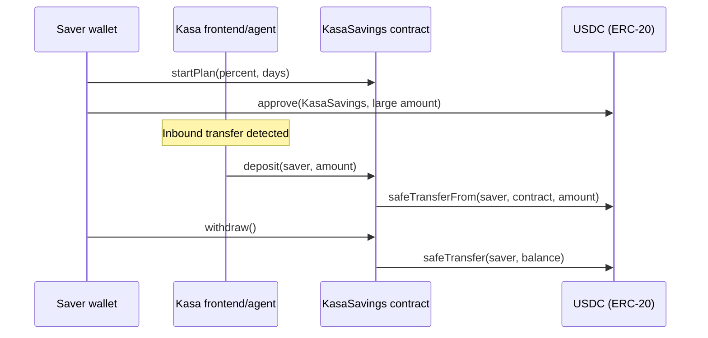

# KasaSavings — Smart Contract Design Document

**Status:** Draft  
**Target chain:** Arc Testnet (Chain ID 5042002) — EVM-compatible, USDC is the native gas token  
**Language/toolchain:** Solidity 0.8.28, Foundry  
**Milestone:** v1 — testnet  

**Review tracker:**
- [ ] Design review
- [ ] Security review
- [ ] Ops review

---

## Action Items (living)

_Empty at draft._

---

## Goals / Non-Goals

**Goals**
- Let a user (saver) open a savings plan: choose a percentage (1–100%) and a duration (1–3650 days).
- Every time the Kasa app detects an inbound USDC transfer to the saver's wallet, it calls `deposit()` with the pre-calculated savings slice, transferring that USDC into this contract on the saver's behalf.
- The saver may withdraw their full accumulated balance at any time — no hard lock enforced (emergency access is a first-class feature).
- After the plan's duration expires, no new deposits are accepted for that plan; the saver may start a fresh plan.
- One active plan per address at a time.

**Non-Goals**
- No yield, interest, or investment of locked funds.
- No multi-token support — USDC only (Arc Testnet: `0x3600000000000000000000000000000000000000`).
- No multi-plan concurrency per user.
- No protocol fee.
- No cross-chain functionality.
- No upgradeability in v1.

---

## Requirements

**Functional**
1. `startPlan(uint16 savingsPercent, uint32 durationDays)` — opens a plan for `msg.sender`. Reverts if a plan is already active.
2. `deposit(address saver, uint256 amount)` — transfers `amount` USDC from `saver` to contract, credits `saver`'s balance. Reverts if no active plan or plan is expired.
3. `withdraw()` — transfers the full balance back to `msg.sender`, zeroes their balance, marks plan inactive. Works any time (including mid-plan).
4. `resetPlan(uint16 savingsPercent, uint32 durationDays)` — cancels existing plan (if any) and starts a fresh one. Does NOT withdraw balance — saver explicitly calls `withdraw()` first if they want to extract funds before resetting.
5. `getPlan(address saver)` — view: returns `(savingsPercent, startTime, endTime, balance, active)`.

**Security**
- Only the saver can call `withdraw()` for their own funds.
- Only the saver (or their explicitly-authorised caller) can open a plan for their address. In v1 the saver calls `startPlan` themselves; `deposit` is callable by anyone on behalf of a saver (the Kasa app calls it) but is bounded by the saver's active plan.
- `deposit` uses `transferFrom` — the saver must have pre-approved the contract, keeping custody logic simple.
- No path allows the contract owner to move user funds.
- Integer arithmetic uses checked Solidity 0.8 built-ins; no `unchecked` blocks.

---

## Terminology & Actors

| Term | Definition |
|---|---|
| Saver | Wallet address that owns a savings plan |
| Plan | A (percent, duration) pair open for a saver |
| Active plan | `block.timestamp < endTime` AND `active == true` |
| Expired plan | `block.timestamp >= endTime` (no new deposits accepted) |
| Kasa app | The frontend + agent that calls `deposit()` on the saver's behalf |

**Actors**

| Actor | On/off-chain | Trust level | What they can do |
|---|---|---|---|
| Saver | On-chain (EOA or smart wallet) | Trusted (self) | startPlan, resetPlan, withdraw |
| Kasa app | Off-chain → calls contract | Semi-trusted | deposit (bounded by saver's plan) |
| Anyone | On-chain | Untrusted | deposit on behalf of saver (no special privilege beyond plan bounds) |
| Contract deployer | Off-chain at deploy time | N/A post-deploy | No ongoing privileges — immutable contract |

---

## Language / Runtime

- Solidity 0.8.28, locked via `pragma solidity 0.8.28`.
- Foundry (`forge build`, `forge test`).
- EVM version: Paris (Arc Testnet).
- OpenZeppelin 5.1.0 (`ReentrancyGuard`, `SafeERC20`).
- No proxy — immutable v1.

---

## Transaction & Execution Model

Each function is atomic. Re-entry surface: `withdraw()` calls `USDC.transfer` (an ERC-20 call into the USDC contract). CEI discipline applied: state is zeroed **before** the external call. `nonReentrant` guard added as defence-in-depth. `deposit()` uses `SafeERC20.safeTransferFrom` — no re-entry surface because no state is read after the call.

---

## Chain Standards & Interfaces

- Interacts with USDC ERC-20 at the Arc Testnet predeploy address.
- Uses `IERC20` + `SafeERC20` from OpenZeppelin.
- No ERC-721 / ERC-1155. No ERC-1271 or Permit2 in v1.

---

## Architecture Overview



**Flow of funds**

| Step | Who moves what | Invariant |
|---|---|---|
| deposit | Saver's USDC → contract | `sum(balances) == USDC.balanceOf(contract)` |
| withdraw | Contract USDC → saver | Balance zeroed before transfer |

Resting-state invariant: `sum(balances[all savers]) == USDC.balanceOf(address(this))`.

---

## Contract Design

### Roles

| Role | Holder | Permissions |
|---|---|---|
| Saver | msg.sender at startPlan | startPlan, resetPlan, withdraw for their own plan |
| Depositor (anyone) | Any address | deposit on behalf of a saver (if plan active) |
| — | — | No contract owner role post-deploy |

### Storage layout

```solidity
struct Plan {
    uint16  savingsPercent;   // 1–100
    uint32  startTime;        // unix timestamp
    uint32  endTime;          // startTime + durationDays * 1 days
    uint256 balance;          // accumulated USDC (6 decimals)
    bool    active;
}

mapping(address => Plan) public plans;
IERC20 public immutable usdc;
```

### Functions (write)

| Function | Caller | State mutated | Events | Reverts when |
|---|---|---|---|---|
| `startPlan(uint16 percent, uint32 days)` | Saver | creates `plans[msg.sender]` | `PlanStarted` | plan already active; percent 0 or >100; days 0 or >3650 |
| `deposit(address saver, uint256 amount)` | Anyone | increments `plans[saver].balance` | `Deposited` | no active plan; plan expired; amount 0 |
| `withdraw()` | Saver | zeroes balance; sets active=false | `Withdrawn` | balance == 0 |
| `resetPlan(uint16 percent, uint32 days)` | Saver | overwrites plan (does NOT withdraw balance) | `PlanReset` | same validation as startPlan |

### Events

| Event | Params | When |
|---|---|---|
| `PlanStarted` | saver, percent, startTime, endTime | startPlan succeeds |
| `Deposited` | saver, depositor, amount, newBalance | deposit succeeds |
| `Withdrawn` | saver, amount | withdraw succeeds |
| `PlanReset` | saver, percent, startTime, endTime | resetPlan succeeds |

---

## Deployment & Initialization

Constructor arguments:
- `address usdc_` — the USDC ERC-20 address (Arc Testnet: `0x3600000000000000000000000000000000000000`)

No `initialize` — not upgradeable. No `_disableInitializers` needed.

---

## Upgradeability

None. v1 is immutable. Migration path if needed: deploy a new contract, users withdraw from old and deposit to new. No proxy.

---

## Key Management & Signing

No off-chain signing in v1. All actions are direct on-chain calls. No EIP-712, no Permit2.

---

## Security Considerations

| Vulnerability | Applicable? | Mitigation |
|---|---|---|
| Reentrancy | Yes — `withdraw` calls external USDC `transfer` | CEI: zero balance before transfer; `nonReentrant` guard |
| Access control | Yes — withdraw must be caller-only | `require(msg.sender == saver)` implicit via `plans[msg.sender]`; withdraw only touches caller's balance |
| Integer overflow/underflow | Solidity 0.8 checked | No `unchecked` blocks |
| Unchecked external call | Yes — USDC transferFrom | `SafeERC20.safeTransferFrom` / `safeTransfer` |
| Fee-on-transfer tokens | No — only USDC (not fee-on-transfer) | USDC on Arc is a standard ERC-20 |
| Signature replay | N/A — no off-chain signing | — |
| Front-running | Low — deposits are bounded by active plan | No value extractable by front-running |
| Flash-loan / oracle | N/A — no oracle | — |
| Denial of service | Low | No loops; pull-over-push (`withdraw` is caller-initiated) |
| Delegatecall / proxy | N/A — no proxy | — |
| Timestamp dependence | Yes — plan duration uses block.timestamp | Tolerance is days, not seconds; acceptable |
| Approval persistence | Yes — saver approves contract | Saver controls their own approval; no dangling max-approval issued by contract |
| Centralization risk | Low — no owner post-deploy | No privileged key can move funds |

---

## Trust Model & Threat Analysis

| Actor | Worst-case if compromised | Mitigation | Detection |
|---|---|---|---|
| Kasa app wallet | Calls `deposit()` with arbitrary amounts up to saver's USDC approval | Saver controls their own ERC-20 approval; deposit is bounded by their balance and approval | Watch `Deposited` events; saver can revoke approval |
| Saver wallet | Full control over their own plan and balance — no impact on other savers | Isolation: each plan is a separate mapping slot | N/A |
| Contract deployer | Zero post-deploy privileges | Immutable, no owner stored | — |

---

## Emergency Response

- **Saver emergency exit**: `withdraw()` is always callable, no timelock. Empties their balance immediately.
- **No contract-level pause**: v1 is immutable and owner-less. A bug requires deploying a new contract and having users migrate.
- **Stuck tokens**: if USDC is accidentally sent directly (not via `deposit`), no recovery path exists in v1 — this is a known limitation. Savers should only send USDC through `deposit`.

---

## Failure Scenarios

- `deposit` called after plan expires → reverts cleanly; balance untouched.
- `withdraw` called with zero balance → reverts cleanly.
- Saver loses their key → funds are stuck (same as any self-custodied wallet). v1 has no social recovery.
- USDC contract upgrade → immutable reference at constructor; operator would need to redeploy if USDC address changes (Arc predeploy is stable).

---

## Testing Strategy

- Unit tests: Foundry (`forge test`). Coverage targets: all revert paths, all happy paths, fuzz on `savingsPercent` and `durationDays`, invariant: `sum(balances) == USDC.balanceOf(contract)`.
- Static analysis: Slither.
- No fork tests needed in v1 (no external protocol dependencies).

---

## Third-party Libraries

| Library | Version | Dependency? | Why | Security reviewed? |
|---|---|---|---|---|
| OpenZeppelin contracts | 5.1.0 | Yes (pinned) | `ReentrancyGuard`, `SafeERC20`, `IERC20` | Yes (OZ audited) |

---

## Common Patterns / Worked Examples

**Start a plan and make two deposits:**

1. Saver calls `startPlan(10, 90)` → plan: 10%, 90 days from now, balance = 0.
2. Saver calls `USDC.approve(KasaSavings, 1000e6)`.
3. Saver receives 200 USDC. Kasa app computes 10% = 20 USDC, calls `deposit(saver, 20e6)`. Balance = 20 USDC.
4. Saver receives 500 USDC. Kasa app calls `deposit(saver, 50e6)`. Balance = 70 USDC.
5. Day 91 arrives. Plan expired. `deposit` now reverts.
6. Saver calls `withdraw()`. Receives 70 USDC. Balance zeroed.
7. Saver calls `resetPlan(15, 60)` to start a new plan.

**Emergency withdrawal mid-plan:**

1. Active plan, balance = 30 USDC, 45 days remaining.
2. Saver calls `withdraw()`. Receives 30 USDC immediately. Plan marked inactive.
3. Future `deposit` calls revert until saver calls `startPlan` or `resetPlan` again.
